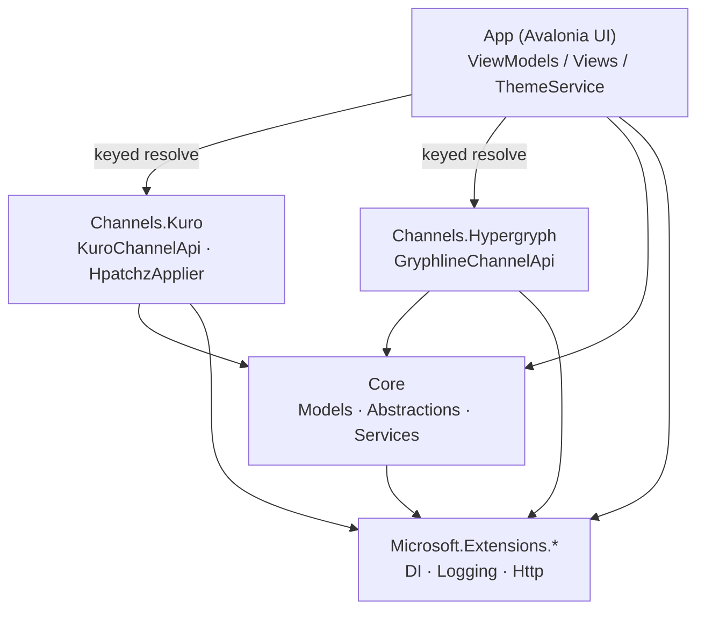
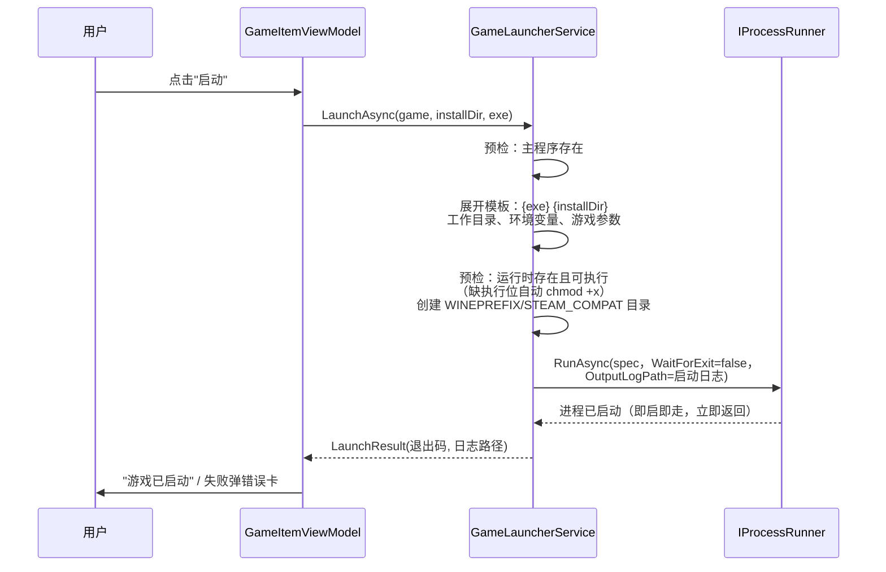
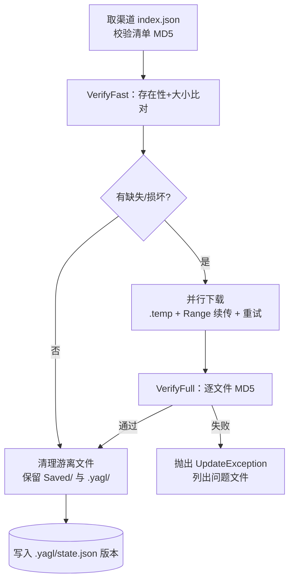
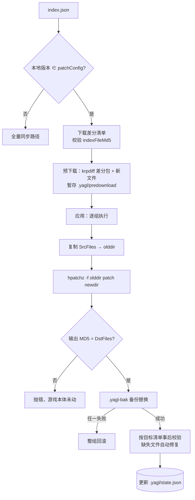
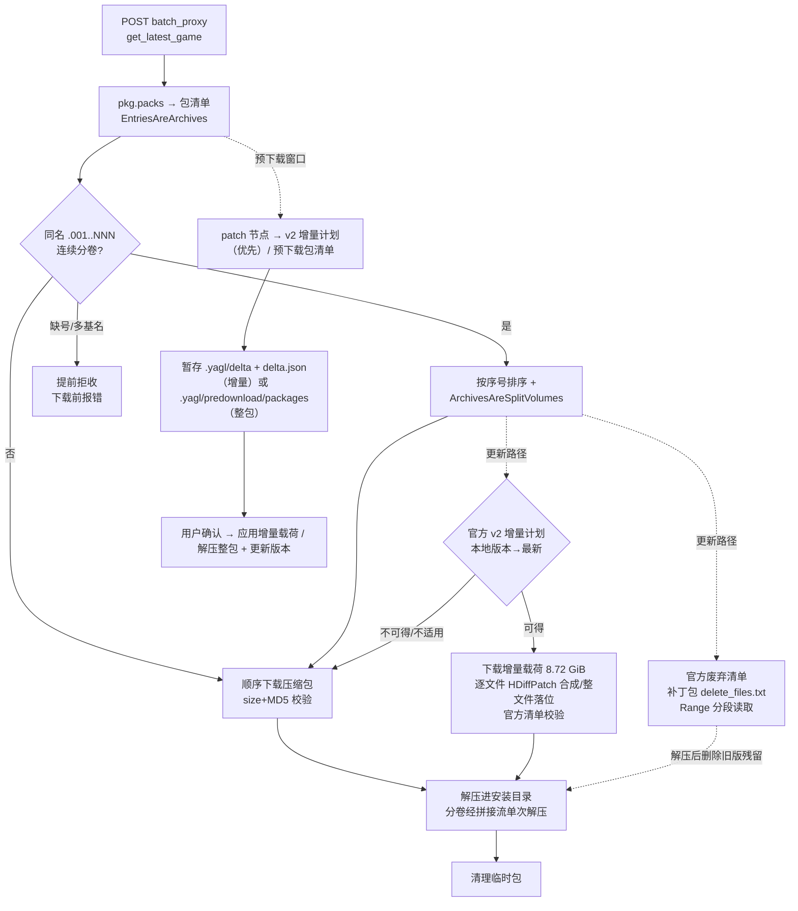
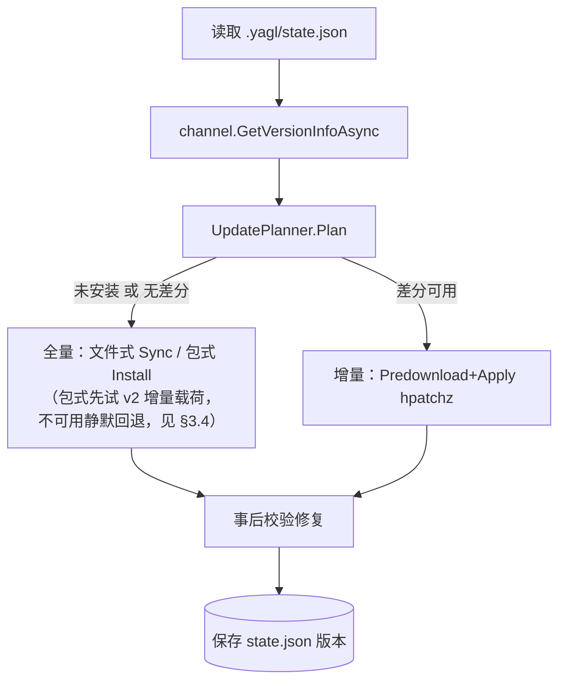
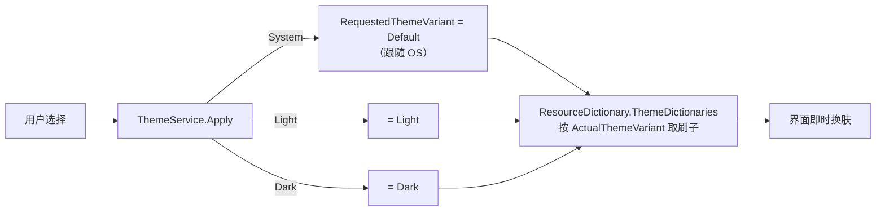

# 架构文档

本文描述 YetAnotherGameLauncher 的分层架构、模块职责与全部核心流程。
配套文档：[DEVELOPMENT.md](DEVELOPMENT.md)（开发流程）、[GAME_CONFIG.md](GAME_CONFIG.md)（配置参考）。

## 1. 分层总览

```
┌─────────────────────────────────────────────────────┐
│                 YetAnotherGameLauncher (App)         │
│   Avalonia 12 UI · MVVM · 主题 · DI 组合根           │
│   Views ←→ ViewModels (CommunityToolkit.Mvvm)        │
└───────────────┬─────────────────────────────────────┘
                │ 依赖抽象（IGameChannelApi / IDownloader / …）
┌───────────────┴─────────────────────────────────────┐
│        Channels.Kuro        │  Channels.Hypergryph   │
│  库洛协议（鸣潮）            │  GRYPHLINE 协议（终末地）│
│  index.json/indexFile 解析  │  batch_proxy 整包协议   │
│  CDN 选择 · URL 拼接        │  版本/包清单 → 包式清单  │
│  HpatchzApplier（HDiffPatch）│                        │
└───────────────┬─────────────────────────────────────┘
                │
┌───────────────┴─────────────────────────────────────┐
│                 YetAnotherGameLauncher.Core          │
│  Models（配置/清单/进度/状态）                        │
│  Abstractions（IGameChannelApi/IDownloader/…）        │
│  Services（目录/下载/校验/同步/增量/包式/编排/启动）   │
│  Utilities（Hashing/Json/FileUtilities）              │
│  根目录单文件：InstallPath / AppPaths                 │
│  零 UI 依赖、零厂商依赖                               │
└─────────────────────────────────────────────────────┘
```

依赖方向严格单向：**App → Channels → Core**。渠道以 DI keyed service 注册
（键即 `games.json` 中 `game.channel`），新增渠道不需要改动 Core 与已有渠道。
操作系统差异同理：`IPlatformInfo`、`IAutostartService` 等平台抽象由组合根
按当前操作系统注入 Windows/Linux 实现，业务代码只依赖接口。

### 模块依赖图



## 2. 关键抽象

| 抽象 | 职责 | 生产实现 | 测试替身 |
|---|---|---|---|
| `IGameChannelApi` | 版本查询 / 全量清单 / 增量清单 / 预下载清单 / 废弃清单 / v2 增量计划 | `KuroChannelApi`、`GryphlineChannelApi` | `FakeChannel` |
| `IDownloader` | 单文件下载：Range 续传、重试、MD5/size 校验 | `HttpFileDownloader` | `FakeDownloader`、`StubHttpHandler` |
| `IFilePatchApplier` | 差分合成（单文件模式：终末地 v2 载荷） | `HpatchzApplier`（HDiffPatch 单文件模式） | `FakeFilePatchApplier` |
| `IPatchApplier` | 差分合成（目录模式） | `HpatchzApplier`（HDiffPatch） | `FakePatchApplier` |
| `IProcessRunner` | 外部进程（超时/输出捕获） | `SystemProcessRunner` | `FakeProcessRunner` |
| `IPlatformInfo` | OS 判定、GPU 厂商探测（NVIDIA 走 /proc 闭源驱动，AMD/Intel 走 /sys/class/drm 的 PCI vendor；路径可注入）、用文件管理器打开目录 | `WindowsPlatformInfo`、`LinuxPlatformInfo`（DI 按 OS 注入） | `FakePlatformInfo` |
| `IAutostartService` | 开机自启查询/切换（Windows 注册表 / Linux XDG autostart） | `WindowsAutostartService`、`LinuxAutostartService`（DI 按 OS 注册） | 真实现 + FakeProcessRunner（VmFactory 缺省）、FakeAutostartService（VM 状态 API 测试）；集成测试按平台注入真实现 |
| `IBackdropResolver` | 按区域解析详情页背景来源（图/视频 + 首帧海报） | `KuroBackdropResolver`、`EndfieldBackdropResolver`（按渠道键 keyed 注册） | 测试内联假实现 |
| `GameCatalogService` | games.json 加载/校验/原子保存 | — | 配置 fixture |
| `GameInstallService` | 全量同步（校验→并行下载→事后校验→清理） | — | 假下载器 |
| `IncrementalUpdateService` | 差分两段式（暂存→应用/回滚） | — | 假补丁器 |
| `PackageInstallerService` | 包式两段式（下载→解压；分卷归档拼接单次解压） | — | 假下载器 |
| `GameUpdateService` | 面向 UI 的编排入口 | — | 全假组件 |
| `GameLauncherService` | 命令模板解析与启动 | — | `FakeProcessRunner` |
| `ThemeService` | ThemeVariant 三态切换 | — | — |

两类渠道分发模型，由 `GameManifest.EntriesAreArchives` 区分：

- **文件式（鸣潮）**：清单 = 最终游戏文件（path/size/md5），差分入口 `patchConfig` 按旧版本号精确匹配。
  index.json 是双块结构：live→live 的差分入口在 `default` 块、预下载（live→predownload）的差分入口在
  `predownload` 块——`GetIncrementalManifestAsync` 按目标版本选块（2026-09-20 修复：此前只查 default 块，
  预下载窗口期必失败）。预下载可用性 = `predownloadSwitch` 开启且 predownload 块带 `config`。
  CDN 节点表 `cdnList` **仅随 default 块下发、两块共用**（2026-09-29 真机实测：预载块只有
  changelog/config/resources/resourcesBasePath/version 五键）——选中块无可用节点时回退 default 块的
  cdnList，仍无才拒收（2026-09-29 修复：此前对预载块直接抛 "cdnList has no usable node"）。
  增量清单的 **krpdiff 差分条目只经 Groups 表达**（2026-10-02 修复 + 真机实证：清单 resource[] 同时登记
  直下文件与 krpdiff、后者与 groupInfos[].dest 一一同名；留在 Files 会给 krpdiff 套 fromFolder 前缀
  zip/——真机 38/38 全 404，即用户报障的 404 URL——且下载两遍、apply 时被搬进游戏目录）。组的
  PatchSize/PatchMd5 从 resource[] 同名条目回填（真机组层无此二键）；krpdiff URL =
  「差分入口 baseUrl > 块 config.baseUrl > cdn+resources/」三级链（ww-manager `_build_krpdiff_url`
  一致）。**直下文件**的前缀按「条目自身 fromFolder > 列表第一个 fromFolder > 差分入口 baseUrl >
  选中块 config.baseUrl > resourcesBasePath」回退——第 1–3 级与参考实现一致；第 4 级（配置基址）
  参考实现固定取 default 块、本实现取选中块（2026-09-29 真机两形态等值）。真机实证：预载条目的
  差分入口 baseUrl 是差分包目录（作资源前缀三节点全 404）；常规增量条目 baseUrl=zip/ 资源目录且
  清单无 fromFolder，回退链产出与旧实现一致。清单顶层 `deleteFiles`（废弃文件，2026-10-02 真机 6 条
  旧 pak/sig）建模进 GameManifest，Apply 在组循环与落位**之后**删除（官方清单存在 deleteFiles ∩ 组
  srcFiles 交叉——3.6.1→3.7.0 group_37 的 4 个差分源同时在废弃清单，先删会让组差分永久不可行且不可
  自愈，2026-10-02 真机 P1 实锤后修订；删除前先扣除本次更新产物 Files ∪ 组 dstFiles，命中即警告跳过
  ——自相矛盾清单不会误删刚产出的文件，2026-10-03 RF-C；命中清单保留前缀（`PreservedPaths`，档位模式
  = 未选中档位目录）的条目同样跳过——渠道按档裁剪之外的消费端纵深守卫，见 §3.11 档位小节；
  删除失败仍报错中止，重试安全）。差分源缺失或补丁器执行
  失败（2026-10-03 扩展，109 事件形态）时经 dstUrlResolver
  解析缝直下该组产物自救（组级回退；GameUpdateService 懒取目标版本全量清单建 path→URL——官方
  dstFiles 原始条目无 url 字段，但组 dst 路径被全量清单全覆盖且 {resourcesBasePath}/{dest} 直链实测
  可下、md5 与增量条目一致，happy path 零额外请求；解析前核对服务器当前版本与目标暂存版本，
  不一致抛带两版本号的可操作错误——RF-E，2026-10-03，Kuro 全量清单接口忽略请求版本、此缝是唯一
  需自守的消费方）。Apply 链入口让位线程池、组校验与暂存核验走
  异步流式 MD5（重入时全量已应用组 dstFiles 可达数十 GiB，同步哈希曾冻结 UI 线程——真机 73GiB
  假死实锤，重入校验阶段报 Verifying 进度）。
  **hpatchz 自动供给（2026-10-02）**：补丁工具解析顺序 = 显式路径（HpatchzPath 含分隔符，只校验
  不供给）> PATH 自备（优先，永不被遮蔽，原生直跑）> `HpatchzProvisioner` 下载社区验证构建
  （鸣潮 krpdiff 与开源 HDiffPatch 全线构建不兼容：真机实证官方 v4.8.0/v5.1.3 的 Linux 与
  Windows 构建、master 源码自编译一律退出码 109 读不了 krpdiff 头；供给 ww-manager 社区打包的
  hpatchz.exe，MD5 实测校验，产出经官方清单核对）。Linux 经 wine 运行（系统 wine 或已装 Proton
  自带 wine——CompatTools.FindProtonWine，独立 WINEPREFIX 于 tools/hpatchz/ww-v4.8.0/prefix，
  不污染 ~/.wine）；Windows 原生直跑；已就绪零网络。对齐 FFmpeg 库/umu 组件的自动供给哲学。
- **包式（终末地）**：清单 = 压缩包（packs），下载解压即安装；无按版本差分，更新=请求新版本整包，预下载=响应 `patch` 节点。
  解压**只覆盖不删除**，所以更新落地后还要按官方废弃清单清理上一版残留（`IGameChannelApi.GetObsoleteFilesAsync`：
  带本地版本请求时官方补丁包内的 `delete_files.txt`，经 `RemoteZipEntryReader` 的 Range 分段读取取出；
  1.5.3→1.6.4 实测 324 条 / 47.72 GiB 旧 VFS 分块）。
  packs 是**同一归档的字节分卷**（`…official.zip.001…059`，2026-10-17 国服/国际服 1.6.4 实测 59 卷 ≈58GiB）：
  渠道按序号排序并置 `GameManifest.ArchivesAreSplitVolumes`（序号不连续或多基名即提前拒收，
  不让用户先下几十 GiB 才在解压阶段失败），安装器经 `SplitVolumeStream` 把各卷拼成一个可寻址流
  交给 ZipArchive 单次解压——单卷不是合法 zip（中央目录与 EOCD 只在末卷）。

## 3. 核心流程

### 3.1 启动游戏



启动是**即启即走**（fire-and-forget）：`ProcessStartSpec.WaitForExit = false`，
启动器不等待游戏退出、不杀进程树。游戏 stdout/stderr 经输出泵写入
`~/.local/share/yagl/logs/launch-<游戏id>-<时间戳>.log`（逐行读取到 EOF——
不用 `BeginOutputReadLine` 事件：`WaitForExit()` 只排空 stdout，stderr 会丢；
日志路径模式的进程句柄在泵收尾后才释放，`using` 作用域提前 Dispose 会掐断管道）。
游戏秒退的排查线索由日志尾注 + 应用日志共同记录：退出码与存活时长。
**应用级日志**（2026-10-18 增）：组合根在 `logs/` 同目录再挂一份按天的 `yagl-yyyyMMdd.log`
（保留 14 天；写失败静默——日志不得成为新的故障源），更新/预下载/后台任务的 Information 起
事件与异常尾巴都在这里，事故复盘不再只能靠文件 mtime（2026-10-17 立案④）。

**预检**（`BuildPlan` 内）：① 主程序存在（`ExecutableMissing`）；② 模板首段可执行——
裸命令名按 PATH 解析（找不到 → `RuntimeMissing`），绝对路径缺执行位自动补
`chmod +x`（从压缩包解出的 proton 脚本常见，补不上 → `RuntimeNotExecutable`）；
③ `WINEPREFIX` / `STEAM_COMPAT_DATA_PATH` 目录创建（Proton 要求已存在，
失败 → `PrefixCreateFailed`）。失败抛 `LaunchException`（`UpdateException` 子类，
携带 `LaunchFailureKind` 与日志路径），UI 据此弹主题化错误覆盖层：
类目化中文原因 + 可折叠技术详情 + 打开日志目录。

Windows 上若游戏可执行文件的清单要求管理员权限（requireAdministrator），
`CreateProcess` 抛 Win32Exception 740（ERROR_ELEVATION_REQUIRED，无法自提升）：
`SystemProcessRunner` 换用 `UseShellExecute = true` 的全新 `ProcessStartInfo`
经 ShellExecute 启动，由系统弹 UAC；该路径不支持按进程注入环境变量，
配置了自定义环境时记警告放弃。

命令模板支持引号包裹（含空格路径），例如 `wine "{exe}"`；
Linux 上如何运行（umu / 直接运行）完全由配置决定，代码零平台假设。
设置页启动方式二选一：**umu 启动**（默认，`native-umu {exe}`）与**直接运行**（`{exe}`，Windows 唯一方式；
终末地在 `decoyParent` 开启时该路径改由原生 helper 桥接，见下文「诱饵父进程桥」）；
旧版 wine/Proton 模板仍可执行（裸命令名走通用 PATH 语义），仅不再出现在选择器中；
存量 `umu-run {exe}` 模板由 `schemaVersion 5` 一次性迁移升级为推荐链（`MigrateLinuxLegacyUmuTemplatesAsync`）——
外部 umu-launcher 代码已整体移除，手写自定义模板不受影响。
umu 模式旁有 **Proton 发行版选择**（DW-Proton / GE-Proton / UMU-Proton，默认 DW-Proton）：
代号写入 `environment.PROTONPATH` 并即时保存，启动解析与组件准备共用它
（`CompatTools.ResolveNativeProtonRequest` 优先读 PROTONPATH，空配置兜底 DW-Proton——绝不回退 UMU-Proton）。
代号语义 = 只下载所选发行版：本地已装该前缀最新且**架构相符**（wineserver ELF 判定）即直接用
（启动/组件准备不联网、不静默更新），缺失或已装为错架构才按代号拉对应仓库 latest（自愈重装）；
版本更新由设置页"检查更新"按钮显式触发
（`FetchLatestProtonTagAsync` 查上游 tag，确认后 `UpdateProtonAsync` 装新版并清理同发行版旧目录）。
UMU_ID 由 `launch.umuId` 覆盖（对齐 umu 数据库规范 ID：鸣潮 `umu-3513350`、终末地 `umu-endfield`）。
推荐链单一事实源在 `CompatTools.BuildRecommendedLaunch`（默认原生 umu）。原生链在
`NativeUmuLauncher` + `IUmuComponentProvisioner`：

1. 解析/下载 Proton（DW-Proton [dawn.wine Forgejo] / GE-Proton / UMU-Proton [GitHub]
   → `~/.local/share/Steam/compatibilitytools.d`；DW 资产 tar.xz 且目录名去架构后缀）。
   资产按**主机架构过滤**（`-x86_64`/`-aarch64` 后缀：优先同架构、次选无后缀、排除反向——
   GitHub 资产顺序即上传顺序，GE-Proton11-6 曾把 aarch64 排在 x86_64 之前），解压后再以
   `files/bin/wineserver` 的 ELF e_machine 兜底校验，架构不符即中止并清理
2. 读 `toolmanifest.vdf` 得所需 Steam Runtime，缺失则下载到 `~/.local/share/umu/<variant>`（SHA256 校验）
3. `UmuPrefix.Setup` 布好 Proton 兼容 prefix（pfx 符号链接、shadercache、steamuser）
4. `UmuEnvironment.Build` 写完整 STEAM_COMPAT_* / UMU_* 环境
   （与上游 umu_run.py 对齐：`STEAM_COMPAT_APP_ID` 恒为 prefix 路径 MD5、`STORE` 缺省空串；
   配置里的 PROTONPATH 代号不覆盖已解析的绝对路径；
   `STEAM_COMPAT_LIBRARY_PATHS` = 安装目录——上游按 /proc/mounts 探测生成，
   这里直接指向安装目录达到同一 gamedrive 挂载意图）
5. 合并配置环境变量（`environment` + 功能开关）后经
   `{runtime}/_v2-entry-point --verb=… -- {proton}/proton <verb> {exe} [游戏参数…]` 启动
   （`IProcessRunner`，即启即走）

**诱饵父进程桥（终末地 1.6.3+ 启动校验，2026-10-18；Windows 直启接入与迁移见 2026-10-20）**：
游戏启动时会校验**直接父进程**（实现于游戏目录 `OneChannelLC.dll`，四步）：① Toolhelp 快照取直接
父进程；② 镜像文件名与 `parentNames` 忽略大小写全等比对（不中 → `10100`）；③ 对镜像文件调
`WinVerifyTrust`（`WINTRUST_ACTION_GENERIC_VERIFY_V2`，签名不可信/取不到 → `10101`）；④ 枚举签名者
证书比对 SHA-1/SHA-256 指纹白名单（不中 → `10102`）。直启时父进程是容器侧 `umu.exe`（Linux）或
启动器自身（Windows），会被拒绝（弹「请通过官方启动器打开游戏」、退出码 5）。`launch.decoyParent=true`
时启动链先经 `DecoyParentBridge.TryPrepare` 准备：把游戏目录里鹰角签名的可执行文件
（`PlatformProcess.exe` → `UnityCrashHandler64.exe` → `Endfield.exe` 首个存在者；与官方启动器
`Games.exe` 同一张签名证书）复制为诱饵 `Games.exe`，并把 helper 落盘。**桥工作目录自 2026-10-20 起
在启动器数据目录**（`{数据目录}/yagl`，Linux `~/.local/share/yagl`、Windows `%LOCALAPPDATA%\yagl`）
下的 `bridge/<游戏id>/`——游戏安装目录只作为诱饵来源被读取，旧版
`<安装目录>/.yagl/bridge` 由准备逻辑 best-effort 清理（不触碰 `.yagl` 下的状态文件）。helper
`yagl-parent-bridge.exe` 是 **C# 自包含 Windows 单文件**（`tools/wine-parent-bridge/`；`WinExe`
即 GUI 子系统——console 子系统会在无终端的 Wine 下弹 conhost 黑窗，2026-10-20 真机复现），
由 Core 构建目标发布并嵌入资源，**不再把产物提交进仓库**（嵌套 Restore/Publish 显式钉死
`win-x64 + SelfContained`，避免继承外层的 `RuntimeIdentifier`）。诱饵复制在内容与候选一致时
跳过覆盖（Windows 上已挂起的诱饵会锁住镜像文件，第二次启动/孤儿诱饵仍可继续）。两条链共用 helper：Linux
`NativeUmuLauncher` 把容器目标换成 helper、游戏 exe/命令行经 `YAGL_BRIDGE_DECOY/TARGET/CMD/CWD`
（Windows 路径，诱饵用 `Z:` 映射）传递；Windows 直启
`GameLauncherService.LaunchWithDecoyParentAsync` 要求 `commandTemplate` 直接指向游戏 exe（否则
显式报错，不做静默降级），以原生路径注入同一组变量并启动 helper（即启即走）。两条链都额外传
`YAGL_BRIDGE_STATUS`：helper 在**游戏进程创建后**写 `READY`，创建前失败写
`ERROR:<退出码>:<消息>`；launcher 轮询该状态文件而不是看 helper 的退出码——
状态文件写失败/helper 未写 READY 时按超时报错（不静默成功）；**超时按两段计时**（2026-10-21）：
helper 写出首个状态（`STARTING`）前用启动上限（10 s，Linux 链的计时从容器入口
`_v2-entry-point` 启动算起，含 Proton/umu 容器冷启动），helper 开始执行后用 READY 上限（10 s，
游戏进程创建）；两段超时给出不同提示（helper 未启动 / 已启动但游戏进程未创建）；helper 会把游戏自身退出码
（如启动校验拒绝的 5）原样透传，只看退出码会把"游戏已启动但拒绝了自己"
误报成桥故障。helper 以 `CREATE_SUSPENDED` 创建诱饵且永不恢复、经 `PROC_THREAD_ATTRIBUTE_PARENT_PROCESS`
指定为游戏父进程、等游戏退出后 `TerminateProcess` 回收诱饵并透传退出码——**零下载、不依赖官方
启动器、不改游戏文件与 ACE 环境**。处理按平台/阶段不同：**准备**桥失败时 Linux 静默回退直启
（不阻断玩家），Windows 抛可操作的 `LaunchException`（无签名候选时直启必被游戏拒绝）；
准备成功后 **READY 之前**的 helper 失败在两个平台都抛可操作错误（带日志路径），READY 之后
游戏自身的退出码不再当作桥失败。三层判据与三种失败码均经
真机对照实验与通过态实录验证（见 `artifacts/bugs.md` F89；Wine 的 `UpdateProcThreadAttribute`
指针语义坑见 `docs/PITFALLS.md` §3）。

**功能开关 → 环境变量**的映射单一事实源是 `CompatTools.FeatureEnvironment`：
`useWayland` → `PROTON_USE_WAYLAND=1`（DW 同时接受 PROTON_ENABLE_WAYLAND 别名，同一 compat 选项）；
`upgradeDlss` → `PROTON_DLSS_UPGRADE=1` + `PROTON_ENABLE_NVAPI=1`（DLSS 依赖 NVAPI；由 protonfixes
在启动时替换游戏内 nvngx_dlss.dll，仅 NVIDIA 生效）；`enableProtonLog` → `PROTON_LOG=1` +
`PROTON_LOG_DIR={应用日志目录}`。两个启动链在各自入口做同型合并、开关键优先于用户同名配置：
模板直启链在 `GameLauncherService.BuildPlan`，原生 umu 链在 `GameItemViewModel.LaunchAsync`
（经 `extraEnvironment`）。原生链合并时 `UMU_ID`/`GAMEID` 在 `launch.umuId` 显式设置时不被
配置 env 反超（首运托管的 `umu-{游戏id}` 残留曾使 umuId 覆盖静默失效）；`PROTONPATH`
始终不反超（配置存代号、env 已解析为绝对路径）。

**自定义启动选项 → 启动面**按 Steam 启动选项语义解释（2026-10-03，字段与填写规则见 GAME_CONFIG.md
`launch.environment` / `launch.arguments`）：`KEY=VALUE` 条目注入子进程环境块（等价于 Steam 里写在
`%command%` 之前的区域，末尾占位符自动补全）；显式 `%command%` 之后的 token 作为游戏命令行参数，
两条链同序追加在游戏 exe 之后、启动器生成的 `-krqlv` 档位参数之前（模板直启链拼进命令串经
`SplitCommand` 引号感知拆分，原生 umu 链经 `BuildEntryCommand` argv 尾部）。词法与切分单一事实源 =
`LaunchOptionsText`。

外部 `umu-run` zipapp 路径（`UmuLauncherInstaller`）已整体移除；存量模板经 schemaVersion 5 迁移转入原生链。
Wine prefix 统一在 `{数据目录}/yagl/prefixes/<游戏id>`（`STEAM_COMPAT_DATA_PATH` 同址），
绝不写入游戏安装目录——安装同步的清单外清理不会误删 prefix（`GameInstallService.PreservedEntries`
保留名单把 prefix/`compatdata` 列入纵深防御：prefix 内有注册表/着色器缓存/用户数据，误删即毁游戏环境）。
本地解析同样按主机架构过滤（`FindInstalledProton` byName 与 `FindLatestLocalProton` 经 `MatchesHostArch`）：
已装的错架构目录视同缺失、下次启动自动重装自愈。更新清理（`PruneOtherProtonVersions`）与安装共用
`proton.lock`；**删除旧版前先把受管 prefix 指向它的 builtin 链接当场迁到新版**（`WinePrefixBuiltinRepair.RepointTree`
+ `RepairDangling` 全 prefix 递归重链——F46：Proton 型 prefix 的 builtin 文件全部链接进创建它的 Proton 目录，
删被引用旧版 = 链接全悬空、wine 任何 PE 进程起不来）；迁不干净（新版缺同路径文件）则保留旧版并记日志。
更新确认覆盖层提示先退出运行中的游戏（删旧版会让运行中游戏的延迟加载失效）。
（唯一例外是首运配置生成：Linux 会把默认 `{exe}` 升级为推荐链再落盘，见 GAME_CONFIG.md。）

### 3.2 全量同步（文件式）



### 3.3 增量更新（鸣潮 krpdiff，两段式）



要点（与参考实现 wutheringwaves-cli-manager 对齐）：

- 差分入口按**字符串精确匹配**本地版本；
- 单组失败只回滚该组（已成功的组保留），整体可重试直至成功；
- 中断后可重复"应用"：目标文件已就绪的组自动跳过；
- 事后校验使用目标版本全量清单，缺失文件走全量修复路径。

### 3.4 包式安装/预下载（终末地）



增量要点（2026-10-17 实测与接线）：更新优先走官方 v2 增量载荷（`GetDeltaPackageAsync`，9 卷 ≈8.72 GiB 替代
整包数十 GiB）：载荷是分卷 zip，条目为"本地头 + 数据"块且**中央目录尺寸不可信**（真实跨度按下一条目偏移界定，
`MultiPartZipEntryReader`）；差分条目是 WinZip AES-256 内层 zip（口令 = `cd_key`，`WinZipAesReader` 自实现解密），
解出即标准 HDiffPatch 单文件补丁（hpatchz 应用）；整文件条目**流式落位**（边解密边写临时文件，
1.2 GiB 条目不再入内存成型，2026-10-18）、清单"仅校验"条目核对在盘
（尺寸 + 内容 md5——官方 `verify_files.json` 是二进制加密块、参考实现也不用，清单自带目标 md5 是唯一判据，2026-10-18）、
静态条目（dll/exe 等）覆盖游戏根（`config.ini` → `config.ini.new`）；就地逐文件替换的前提是
**基文件与目标零重叠**（实测 224/224，无需数十 GiB 暂存）。**应用幂等/续跑**（2026-10-19 三审）：
逐节点先按清单目标 md5 判"已到位"跳过（差分节点以基 md5 为判据，内容已应用再走一遍会被判
"不适用"而错误回退整包），载荷分卷不在应用器内删、留到调用方提交点（状态落盘之后）——
应用期暂停/掉线后重跑零下载收敛。
不适用（基文件缺失/内容不符/分卷异常/清单取不到/**载荷自身不可用**——条目读不出、产出与官方清单
不符或补丁非零退出（`UpdateException`），按 Warning 记录）静默回退整包并清掉载荷暂存；
**补丁工具不可用**（工具缺失/自动供给失败/进程起不来：`PatchToolUnavailableException`）则例外（2026-10-18）——
折算 `DeltaPackageSupplyException`：载荷是好东西，**保留**载荷暂存（修复工具后重试零重下）且**不回退整包**，
抛带"载荷已保留"指引的可重试错误。
下载前另有**空闲空间预检**（需求 = 载荷 + 各载荷节点净增长 + 最大单节点瞬态；`DiskSpace` 探测不出即放行，
空间不足抛可操作错误且不回退整包——整包只会要得更多）。

**预下载链同样接 v2 增量**（2026-10-18 接线）：预下载窗口内先取增量计划，把载荷分卷下到 `.yagl/delta`
并写 `delta.json`（计划）+ 带 `StagedAsDeltaPackage` 标记的暂存清单（应用阶段据此识别）；整包预下载的
旧暂存（`.yagl/predownload/packages`）在增量暂存成功后清掉。计划的目标版本按 `patch.version` 认
（2026-10-19 复核修正）：窗口期 `response.version` 仍是线上版本、patch 节点描述的是预下载目标，
渠道守卫对两者取或（清单 `version` 仍逐字符核对），否则窗口内计划恒取不到、静默退回整包。
载荷下载/形态失败回退整包时**只清增量侧**（载荷 + `delta.json` + 增量标记清单），保留 `packages/`
供回退路径按 size/MD5 复用——整删预下载目录会把数十 GiB 已暂存整包作废重下。
应用时载荷不适用/不可用 → 清掉增量暂存并
**重走常规更新流程**（重探当前最新版本，内部再试增量、必要时回退整包）——不把"下载时的目标版本"
当成"当前最新"落盘；补丁工具不可用则与直接链同语义（保留载荷、抛可重试错误）。

清理要点：`GetObsoleteFilesAsync` 取不到（渠道不支持/服务器已前移/网络失败）不影响更新，只是
残留保留到下次；删除只针对清单点名且**不在本次解压产物**中的文件（清单自相矛盾时以产物为准），
路径必须落在安装目录内且不穿过链接，状态目录 `.yagl` 不删，删空后回收腾空目录；单条失败只记日志继续。

要点：分卷形态（2026-10-17 国服/国际服 1.6.4 实测 `Beyond_Release_…official.zip.001…059`，
59 卷 ≈58GiB，除末卷每卷 1GiB）下各卷只是同一归档的字节切片，中央目录与 EOCD 只在末卷——
把单卷当独立 zip 解压必报 `End of Central Directory record could not be found`。
`SplitVolumeStream` 把各卷呈现为一个连续可寻址流交给 ZipArchive 整体解压一次，
不落盘拼接副本（数十 GiB 分卷不产生等量临时文件与整卷复制时间）；预下载与两段式应用同源生效。

### 3.5 更新编排（GameUpdateService）



`PredownloadAsync` 在本地版本已达到/超过预下载目标时**短路为幂等空操作**（F66，2026-09-29）：
否则包式渠道会无条件整包重下数十 GB、Kuro 侧给出"no patch for local version V2"的自相矛盾文案
（此时 local 就是 V2）；UI 预下载入口同步按本地版本隐藏（预下载目标版本未知的渠道保持旧可见性），
短路返回的 From==To 摘要以 `predownload_alreadyCurrent` 文案提示"无需重复预下载"。
预载暂存**重跑不重置**（2026-10-02）：完好暂存文件按 size+MD5 条目级核验跳过、`.temp` 由下载器
Range 续传（此前整树清空会把已下载的几十 GB 全部作废重下）；清单版本切换的孤儿残留由 Apply 成功时
的整目录清理回收。旧版本写入的暂存清单没有分卷标记（字段缺省 = false），Apply 阶段按
`SplitVolumeNaming` 复算认定并重排（2026-10-17 复审补：否则分卷暂存会退回逐卷解压——正是用户报障
形态，而此刻几十 GiB 已下载完；序号不连续则明确报错）。下载进度为**字节级实时**（下载器 64KB 回调 → `ByteProgressAggregator` 全局增量 →
100ms 节流投递，三条链共用；进度口径 = 本地已就绪字节，含续传起点；重跑暂存时的逐块 MD5 核验同样
经该管道上报字节——判未就绪时负增量回吐，故核验阶段也有进度与速度反馈），UI 端 `GameItemViewModel`
按 ≥0.4s 采样 EMA 平滑显示下载速度。HTTP 4xx（除 408/429/416 特判）为永久失败、单次终止带状态码
（404 重试三次只是拖长失败，2026-10-02 用户 log 实证）。

### 3.6 主题切换



`Apply` 可从任意线程调用（后台初始化场景）：跨线程时经 `Dispatcher.Post` 投递。

### 3.7 背景视频播放子系统

详情页背景的解析、缓存与视频播放管线：配置文件不携带背景地址，缓存元数据记录抓取时的区域与
游戏版本，两者均未变化时直接用缓存（零网络），版本更新后的首次解析才向渠道确认当期背景；
缓存到本地后由 FFmpeg 播放器后台解码上屏，并以循环点分析 + 预卷做到无缝循环。关键机制：

- **背景解析**：keyed `IBackdropResolver` 按渠道解析——
  `kuro`：官方运营配置直连两跳——launcher-config 的 `functionCode.background` 取当期投放哈希，
  再取背景内容 JSON 的 `backgroundFile`/`firstFrameImage`（背景视频 + 首帧图；按语言投放，主语言
  404 自动回退 en/zh-Hans。2026-09-13 实测：历史端点 switch.json 已停止投放背景，官方改哈希寻址）；
  `hypergryph`：官方启动器 `get_main_bg_image` 接口（视频优先、静态图兜底）。
  两渠道一致的单级回退模型：视频不可用时首帧/静态图兜底，解析失败返回 null 交上层处理，不再探测
  本机官方启动器缓存或本地帧序列。
  `GameBackdropService` 把远程背景流式下载缓存到 `%DataDirectory%/backdrops/<gameId>/`
  （`backdrop.*` + `poster.*` + `meta.json`），地址未变不重复下载，离线/下载失败/解析到畸形响应
  （如 WAF 拦截页的 200+HTML，F59）回退上次缓存。
  **版本门控**（产品决策：背景严格跟随游戏版本，卡池轮换等与版本无关的运营投放不触发刷新）：
  `meta.json` 记录 `region`/`gameVersion`，`ResolveAsync(request, gameVersion)` 在区域与版本均未变化、
  文件在盘时直接返回缓存、不调解析器；版本变化后的解析若地址未变则仅升级元数据不重下。
  `ResolveCachedAsync` 纯磁盘读取（启动预加载用），`GetCachedGameVersion` 供 VM 免网络对齐资产版本。
- **启动资产预热与一次性版本检测**（`MainWindowViewModel.WarmupGames` + `GameItemViewModel`）：
  启动时全部游戏并行 `PreloadAssetsAsync`（图标 + 背景仅读磁盘缓存）让侧栏图标即刻可见；
  每游戏每启动一次 `GetVersionInfoAsync`（`GameItemViewModel` 按 SelectedServer 会话缓存，
  选中/切语言/操作完成后的刷新不再打网络；测试经 `ResetVersionCheckCache` 模拟重启），
  版本检测成功且与资产缓存记录版本不一致时才重新解析背景并重取 http 图标。
  图标 URL 缓存于 `%DataDirectory%/image-cache/`（`BackgroundImageService`，URL SHA256 键；
  `ReloadAsync` 绕过缓存强制重取）。区域随界面语言（cn/global），语言切换换区时重新解析新区域。
  离线启动状态行照常提示无连接，资产由缓存兜底。
- **启动遮蔽门控（2026-09-21）**：`App` 启动路径在窗口上屏前 `BeginBootSplash()` 开启全窗遮蔽
  （`MainWindow` 根 Panel 末位的 `BootSplash` 层：主题渐变 + logo/字标 + 自泵脉动条），初始化与
  首个背景预载在遮蔽后进行；`InitializeAsync` 完成后接 `RunBootGateAsync`——有界轮询等首个选中
  游戏的背景就绪，**优先视频首帧**（`HasBackgroundVideo`，进入主界面即见动画、无静态→动态跳变）；
  静态海报（`HasBackgroundImage`）仅在宽限期（1.5s，给视频留出胜出窗口）后兜底放行；叠加最小
  展示时长（0.4s，防全热缓存下一闪而过）；超时（5s，首启下载 FFmpeg 库/视频与慢网络兜底）/
  配置错误/无游戏无条件放行。纯决策在
  `BootGate.ShouldRelease`（放行矩阵单测）；遮蔽可见性/淡出由 `MainWindow` 代码后置驱动
  （IsBooting 属性通知 → `SyncBootSplash`，回 UI 线程再摸控件；淡出为手写自泵 0.25s——
  同迁移编舞纪律：Animation 时钟取自渲染循环，而本应用渲染循环空闲时按需降频（实测 ~10Hz）、
  窗口内无外部泵时无法自举——旧复核环的每秒数万次分发器投递曾"意外承重"充当渲染泵，泵被修掉后
  两方向动画都掉到 ~10fps；手写 `Task.Delay(8ms)` 循环自身就是泵（每拍直写变换基值→失效→渲染），
  插桩复测两方向全程 8ms 一拍零断流；`SplashAnimationEnabled` 测试开关）。
  `IsBooting` 默认 false：headless 测试与截图导出不受影响，仅生产启动路径显式开启。
- **播放**：`FfmpegVideoBackdropPlayer` 后台线程解码（Windows D3D11VA / Linux VAAPI→CUDA(NVDEC)
  硬解，按序尝试、设备创建失败自动落到下一项直至回软解；硬解 GPU 帧经 `av_hwframe_transfer_data`
  回读系统内存——回读不拷贝帧属性，pts 必须在回读前从原始解码帧捕获），swscale 转 BGRA 后逐行 blit 进
  `WriteableBitmap`，16ms 节流通知 UI 重绘；`PlaybackClock` 按 PTS 实时节拍
  （落后超阈值重定基线，不做爆发追帧），渲染尺寸 clamp ≤4K（防呆上限：官方投放原样渲染不降采样，
  2026-09 实测投放最高 2324×1392；解码本就按源分辨率全量进行，clamp 只作用于 swscale 输出目标），
  静音不解码音轨。
  硬解日志语义：设备创建成功/失败（含 `av_strerror` 错误文本）各一条，`avcodec_open2` 后再打一条
  协商出的分辨率与像素格式（`2324x1392 vaapi_vld (hardware)` / `2048x1216 yuv420p (software)`）——设备创建成功 ≠ 硬解生效，
  协商格式才是判据；循环点分析源刻意纯软解，不打硬解日志（勿把"软解分析"误读成回退失败）。
- **原生库供给**（`FfmpegLibraryResolver`，与 FFmpeg.AutoGen 9.0 绑定精确配套 = libavcodec 主版本 63）：
  应用数据目录已下载库 → 系统库（Linux 探测 `libavcodec.so.63`——其它主版本 ABI 不配套会崩，宁缺毋滥；
  旧实现拼出 `libavcodec-63.dll`/裸 `dlopen("avcodec")`，Linux 上永远失败，是"背景视频没了"的根因）→
  下载 BtbN LGPL 共享构建（SHA256 校验后解压到 `%DataDirectory%/ffmpeg/<rid>/`；
  2026-09-22 起 ffmpeg/背景/图标缓存统一从 %ConfigDirectory% 迁到 %DataDirectory%——可重建
  缓存归数据目录，config 下的旧副本成遗留、可手动删除）。落位走同卷暂存目录 + **完成标记**
  （标记内容 = 下载资产名，即版本身份）：只信带当前版本标记的目录，无标记（解压中断毒化，F26）
  或版本不匹配（App 换绑新版 FFmpeg 后的旧版目录）先删再重下自愈，防旧版库被静默绑上后 ABI 错配；
  下载/解压失败（瞬态）保持"未尝试"下次重试，确定性不可用（上游布局变化/checksums 缺条目）锁死
  永久失败防每次会话重下 60-72MB。
  **解压必须还原符号链接**（2026-09-24 P0 实锤）：SharpCompress `WriteEntryTo` 对 SymbolicLink 条目
  摊平成 0 字节普通文件——BtbN 包里全部短名 soname（`libavcodec.so.63` 等）以链接形态存在，
  本机下载目录 14 个短名曾全 0 字节（2026-09-24 实测）；
  `ExtractArchive` 经 `IEntry.LinkTarget` 还原真链接（目标限同目录裸文件名，逃逸即拒）。凡解包
  不可信外部归档都要显式处理链接条目（zip `\` 条目名坑同族，见 `PackageInstallerService.ExtractArchive`）。
  **目录内库按依赖序预载**（同日 P0 实锤）：BtbN 库间 DT_NEEDED 只有同伴 soname 且**无 RUNPATH**，
  glibc 不会到被加载库自己的目录找依赖——不按 `LibraryDependencyOrder`（avutil 最先、avcodec 先于
  avformat）先 dlopen 驻留，avformat/avcodec 必落 AutoGen throw-stub、起播抛 `NotSupportedException`。
  就绪判定不能只探 `av_version_info()`（avutil 独立可加载 + ABI 稳定，会放行残缺绑定）——探针必须
  覆盖实际调用面（教训泛化见 DEVELOPMENT.md §3.6）。
  **测试缝与 DI**：构造签名 `FfmpegLibraryResolver(proxyManager, logger?, downloadClient?, downloadRoot?, systemLibraryProbe?)`
  的三个可选缝供测试注入（`StubHttpHandler` + 临时目录根，先例 `VideoBackdropPlayerCtsTests`/
  `FfmpegLibraryResolverDownloadTests`——否则无库新环境会真实下载约 60–75MB 并写真实用户目录；
  `systemLibraryProbe` 注入恒 false 以消除"本机装了配套系统库"的分支差异，只门控系统库探测分支）。
  DI 注册必须走**显式工厂**：容器注册过 `HttpClient`（全局 30s）后，类型激活会把 `downloadClient`
  的 null 默认劫持为容器实例、15 分钟专用超时成死代码（组合根装配断言钉住）。
  **AutoGen 函数委托解析结果是进程级缓存**（2026-09-25 /tmp 探针实锤）：`FunctionResolver` 每次调用
  都被咨询，但每个函数只解析一次——null（零句柄 + throwOnError=false）与成功委托均缓存，仅 resolver
  抛异常会重新咨询。同进程任何先行 TryBind 都会令后续 resolver 实例被完全绕过（2026-09-25 CI Linux
  实锤 false+0、本机全量实锤 true+0，双形态同一根因）——断言实例内部状态（解析计数/缓存内容）必须经
  `PrimeResolutionCacheForTests` 直驱缝（不经 AutoGen 缓存），集成路径只断言可观测结果；先例
  `EnsureReady_MissingLibraries_ResolveEachLibraryAtMostOnce`。
  **改本链（`FfmpegLibraryResolver`/FFmpeg 绑定/dlopen）必须真机冒烟**：绑定成功路径无法离线覆盖
  （测试夹具是假库字节，真绑定每进程只有一次机会），最低验证 = 跑应用看 `FFmpeg libraries ready`
  日志 + 首帧输出格式日志（`decoder output … (hardware|software)`——硬解真正生效的判据；打开瞬间
  pix_fmt 恒 AV_PIX_FMT_NONE 不可作判据，"hw device attached" 只说明设备挂载成功）+
  无 `Video backdrop playback failed`（DEVELOPMENT.md §3.6）。
- **无缝循环（v2，2026-09-21）**：`SeamAnalyzer` 把头/尾各约 3s 的帧缩为 64×36 **RGB** 缩略
  （纯灰度会漏掉同亮度不同色相的跳变），按综合分搜索循环点——三通道全局平均差 + 最差分块
  （8×4 网格）均值的加权惩罚（局部动作跳变不被全局平均淹没）+ 后续 2 帧的时序连续性项
  （切口两侧运动趋势一致，拒绝"姿势相似但速度相反"）。命中候选按分排名、头帧间距 ≥2s 去重
  保留前 3 个供**多循环点轮换**——每过一圈换切点，重复周期×3 且每圈路径不同；无阈值内命中时
  取全局最优配降级标记（配最长淡化），**绝不回退未分析的整段循环接缝**。起播不 seek（从流头
  顺序读取、渲染前丢弃起点之前的帧）；**边界精确到帧**：终点判定渲染分析选中的尾帧本身、丢弃其
  后一帧（旧判据 `>=` 把选中尾帧丢掉，实际切口与分析最优对错位一帧，快运动下可感知）。
  **分析与播放并行（2026-09-21 调优）**：分析要顺序软解全片采尾窗（秒级），挡在首帧前是
  "静态海报→视频"延迟的主要来源——首轮按整段循环（流头→EOF）立刻起播出画，后台任务的
  分析结果在下一个循环边界（`RotateLoopPlan`）收编为计划首对；分析慢于首轮结束只会多整段
  循环一两圈，不阻塞出画。
  临近循环终点前 2s 由第二个解码源后台预解码下一循环开头 10 帧，经 `PrerollHandoff` 交接状态机
  交接（上一预卷任务未完成则跳过本次触发、本圈稍后帧重试——防新句柄覆盖旧句柄把在途任务从
  Stop 的 join 中孤儿化，也避免同一硬解栈双预卷并发解码，F51），到达终点时预卷源整体收编、
  先消费预解码帧，零间隙续播；收编时按接缝差自适应——低于硬切
  阈值（3.0，严于命中阈值）直接硬化切，否则淡化时长随差值线性映射 0.15~0.7s（固定 0.6s 长溶解
  本身就是醒目的循环信号）。预卷未就绪回退为重开全新解码源 + 最长交叉淡化。轮换只换切点不破坏
  配对：切口永远是"某候选的尾帧 → 该候选的头帧"，预卷按当圈头帧对齐、`RotateLoopPlan` 在
  `HandleLoopEnd` 两路径收尾推进。
- **退出与解码失败韧性**：窗口 Closing / 程序性 `ShutdownRequested` 都会先停播放再进入平台拆除——
  退出期 GPU 解码栈可能失效（2026-09 实测：NVIDIA + nvidia-vaapi-driver，点 X 退出时 VAAPI/CUDA
  全部初始化失败），解码循环若继续运行会以每帧两条的速度向 stderr 刷
  "hardware accelerator failed to decode picture"。运行期另有 `DecodeGuard` 两级熔断（纯状态机，
  决策表单测）：单路解码源连续 32 个视频包无输出帧（正常 h264 B 帧重排深度上限 16）判坏死放弃；
  重开/收编后的解码源仍未产出有效回（≥0.25s 且 ≥8 帧）连续 3 次即停止播放——帧位图清空后
  `FrameSurface` 不绘制，静态海报自然兜底，下次进详情页重新起播可自愈。demuxer EOF ≠ 流结束：
  EOF 后向解码器发 NULL flush 包 **drain**，吐出 B 帧重排缓冲的尾帧再报流结束（F34——不 drain
  则每圈接缝提前 0.1-0.5s 丢尾帧）。
  **停止即清帧**：`Stop`（保活淘汰/退出/窗口关闭/列表重建共用；一切切页走暂停保活，不在此列）
  取消循环、推进代际并清空帧缓冲——全停后迟到的旧帧通知（解码线程经 UI 线程 Dispatcher
  异步投递）以空帧缓冲为证不再点亮视频层（`GameItemViewModel` 以 `Frame` 非空为准）；
  丢弃的帧位图（尺寸重建/循环淡化归零/全清三处）不立即 Dispose——合成器可能仍持有在途
  渲染引用（`IBitmapImpl` 无引用计数保证），退役入队、2s 宽限后冲刷释放（F5，2026-09-24）；
  会话结束（ClearFrame）另有宽限+1s 的后台终末冲刷，刻意不用无视宽限的强冲——提前强释正是
  要消灭的 use-after-free 面（F36）；
  旧循环另受代际门双重约束：`PresentFrame` 过门后方可渲染，`RenderFrame` 在位图拷入后复查代际，
  失配即整帧丢弃、不投递通知（旧画面无从复活；清帧由 Stop 的 `ClearFrame` 在锁内完成）——过门后的
  PTS 等待/sws/拷贝窗口内发生的 `Stop` 也不会让旧画面点亮。
  **有界 join（2026-09-27，退出偶发 VAAPI destroy 报错修复）**：解码源的原生释放在各解码任务
  自己线程的 finally 里执行，`Stop` 若只取消不等待，退出钩子返回后的平台拆除会与
  `avcodec_free_context` 赛跑——`vaDestroyContext` 打在已拆的 display 上偶发刷
  "Failed to destroy decode context 0x…: 1 (operation failed)"（出处 libavcodec/vaapi_decode.c
  `ff_vaapi_decode_uninit`，`VA_STATUS_ERROR_OPERATION_FAILED=1`；播放器内硬解源为主源+预卷源
  两路，与报错两行相容（亦可能为多播放器各自主源））。会话与预卷任务句柄现被捕获（`_runTask`/`_prerollTask`），`StopCore`
  在取消+放行门之后以共享截止时间（默认 2s，超时记警告照常放行不悬挂退出）join 二者——退出路径
  因此真正保证"原生释放先于平台拆除"；新起播入口的 `StopCore` 同理先等上一代源释放完，消除旧
  free 与新硬解设备创建的交错。循环点分析任务**刻意不 join**：纯软解无 VAAPI 面、不产生该报错，
  而全片软解秒级耗时，join 会把它拖进退出路径。`DecodeSource.Dispose` 的原生收尾段另有进程级
  串行锁（libva/NVENC 对并发 destroy 不保证线程安全——主源/预卷源乃至多播放器实例的 free 互斥）。
  另：PlayAsync 后台任务的收尾只在**仍是本代**时清会话标志——被新一代起播抢先的过期任务
  不得把新会话标成失活（VM 续播快路径会因此误走重启，2026-09-21 修复）。
- **起播与停止的生命周期（2026-09-20 复审补齐，2026-09-26 修复清账批更新）**：播放器侧 `PlayAsync` 收尾
  先摘共享 `_cts` 引用，**自然结束路径同样先 `Cancel` 再释放**——循环点分析后台任务持同一令牌顺序软解
  全片（预卷任务受 `PrerollFrames=10` 上限快速收敛），不取消则两者的解码都在白烧 CPU；且 CTS `Dispose`
  后 `Cancel` 抛 ODE（2026-09-26 探针仲裁，docs/PITFALLS.md §1），Cancel **必须前于** Dispose，`StopCore`
  侧对摘除/释放竞态窗口的 `catch (ObjectDisposedException)` 是承重防御。会话与预卷任务句柄由弃元改
  捕获（`_runTask`/`_prerollTask`），供 `StopCore` 的有界 join 消费（上条）——`PlayAsync` 入口的
  `StopCore` 因此天然先等上一代会话原生释放完，再开新解码源。预卷对齐丢弃起点之前的帧时，**无 pts
  （NaN）帧同样丢弃**——不可对齐帧若入列会以队列头形态在接缝处呈现错位内容；VM 侧 `StartVideoAsync` 以起播
  代际标记——起播窗口内被后发起播抢先的旧调用失败时不再执行 VM 级 StopVideo 清场（否则会误杀新一代起播，
  视频层不再点亮直到离页再进），只有最新一次起播有权清理。
- **切页暂停保活与播放器按游戏独占（2026-09-21）**：播放器不再共享单例——DI 注册为
  **transient**（每 `GameItemViewModel` 一路，原生库准备仍由 `FfmpegLibraryResolver` 单例共享），
  游戏间会话互不干扰，防串台（上一游戏帧通知点亮新页面）由隔离结构性保证。
  `MainWindowViewModel.OnCurrentPageChanged` 驱动：**任何切页**（游戏页 ↔ 游戏页 / 游戏页 ↔
  非游戏页）一律 `SuspendVideo` 暂停——`IVideoBackdropPlayer.Pause` 把解码线程泊车在帧处理点，
  帧缓冲/解码源/订阅原样保留，`HasBackgroundVideo` 不翻（页外不占解码资源但不付重启成本）；
  **重进游戏页** = 续播快路径（会话存活且已订阅时直接 `Resume`，无 500ms 起播延迟、不重开
  解码源/不重新分析循环点；`FrameSurface` 重挂视觉树即画暂停帧）。**保活上限**：暂停队列
  （按暂停先后）超过 2 路（加在播 1 路 = 3 路会话/帧位图驻留上限，`MainWindowViewModel.TrackParkedVideo`）
  时最旧的被全停淘汰，
  该游戏重进凭已解析路径重新起播自愈；`_activeVideoPage` 在切非游戏页后仍指向被暂停的游戏页
  （直到被另一游戏页替换）。播放器侧续播经 `ManualResetEventSlim` 门与取消令牌
  `WaitAny`——暂停中 `Stop` 靠取消令牌正常唤醒退出，醒来重定 `PlaybackClock` 基线（暂停时长不计入
  时间轴）；无会话时 `Pause` 为 no-op（不得留下复位门，新会话启动时 `Set` 另有兜底）；
  播放器 `Dispose` 时 `StopCore` 唤醒泊车线程并有界 join（默认 2s 预算）：正常路径 join 至其退出后
  才释放门（F37——不留内核等待句柄；原"释放瞬间任务仍嵌在 `WaitAny` 里"的窗口随 2026-09-27 的
  有界 join 闭合）；join 超时（病态原生调用）记警告照常放行，残余窗口见播放器 `Dispose` 备注
  （测试 `Stop_JoinBudgetTimeout_ProceedsWithoutHanging` 钉住）。
  `StartVideoAsync` 的起播延迟窗口内离页放弃起播，不在页外隐形解码。
  关窗/程序性退出经 `StopBackdropVideo` 逐游戏全停（含暂停保活中的会话，退出期 GPU 栈必须
  先行静止）；installRoot 变更重建列表时旧 VM 的会话同样在 `RebuildGames` 内全停并 Dispose
  （F77，2026-09-29——释放懒建内核等待句柄，废弃点与释放承诺对齐）。
- **关键约束**：本机 BtbN FFmpeg n9.0 构建的 mov demuxer 上 `av_seek_frame` 后 `av_read_frame` 会提前
  `AVERROR_EOF`（新开 demuxer 或非 EOF 状态都可能），且 seek 返回 0 不报错——
  所有路径一律顺序读取 + 帧丢弃对齐，禁止带时间戳的 seek（循环点对齐即此方案）。

### 3.8 平台后端与窗口状态（Linux）

- **原生 Wayland 优先（Avalonia 12.1 实验性）+ X11/XWayland 回退**：独立 `Avalonia.Wayland` 包 +
  `UseWayland()` 显式启用；`UsePlatformDetect()` 不会自动选中且**无自动回退**（无 Wayland 合成器时
  直接启动失败），故必须条件启用。决策在 `Services/WaylandBackendPolicy`（纯函数，决策表测试）：
  Linux 且 `WAYLAND_DISPLAY` 非空 → 原生 Wayland；`YAGL_FORCE_XWAYLAND=1`（或 true）逃生舱回退
  X11。X11 路径渲染显式 EGL 优先（`X11PlatformOptions.RenderingMode = [Egl, Glx, Software]`——GLX 在
  XWayland+NVIDIA 下是糊化/撕裂高发点），见 `Program.BuildAvaloniaApp(bool)`；NVIDIA 渲染异常的
  排障建议是试 `WaylandPlatformOptions.UseDmabufSwapchain = false`（仅排障手段——代码保持全默认，未设该选项）。已知差异：Wayland 后端窗口 class/app_id 为空
  （`hyprctl clients` 的 class 是空串，窗口规则匹配不到），X11 路径正常。
- **视觉最大化判定**（`Services/WindowStateMapper`，决策表测试）：Wayland 后端会把合成器平铺状态
  误报为 `WindowState.Maximized`（2026-09 实测：平铺 2516×1352 / 工作区 2560×1440 仍报 Maximized），
  且 `Screen.WorkingArea` 按 DIP 上报、`Scaling` 恒报 1（`PixelRect` 契约本应物理像素）；叠加合成器
  `suppress_event=maximize`（忽略应用最大化请求，X11 有状态回报可自愈、Wayland 后端无）会让
  `.maximized` 去圆角样式打在平铺/浮动窗口上——详情页左上圆角丢失即此故。判定 = Maximized 且
  客户区铺满工作区 ±4px（DIP/物理双单位候选），`MainWindow.UpdateMaximizedFlag` 在状态与尺寸变化
  两处时机重判，关闭时按视觉最大化持久化。
- **XWayland 分数缩放与窗口装饰**：X 服务器恒报 96dpi，4K+分数缩放桌面上 UI 按物理像素渲染
  （小字且糊）。`Program.TrySyncXftDpiWithCompositor` 启动时经 hyprctl 把缩放写进 `Xft.dpi`
  （仅用户未设置时；Avalonia 12 已无 `AVALONIA_SCREEN_SCALE_FACTORS` 环境变量）——**仅 X11/XWayland
  路径执行**（原生 Wayland 由合成器直供分数缩放，不应改写会话级 X 资源）。窗口装饰：合成器会无视
  `WindowDecorations="BorderOnly"` 给 X11 窗口画 SSD 标题条，故在 `InitializeComponent()` **之后**设
  `WindowDecorations.None`（XAML 属性会覆盖构造函数先写的值；对原生 Wayland 同样正确，2026-09
  实测 CSD 生效、无双标题）。

### 3.9 依赖安装管线（游戏设置页「依赖」区，2026-09-27）

为单个游戏的 Wine prefix 手动安装可选组件（Bottles cjkfonts 语义的适配落地；首版仅内置 cjk-fonts =
思源黑体 2.004R）。分层与数据流：

- **清单（数据与代码分离）**：`Core/Dependencies/catalog.json` 内嵌资源，声明式 schema——
  `id/version/downloadUrl/fileName/md5/sizeBytes` + `fonts[]`（文件→族名登记）+
  `replacementGroups[]`（旧字体名→目标字体）。`DependencyCatalog` 解析并聚合校验（id kebab 唯一、
  https、md5 32hex、size>0、文件名禁路径段与 `..`、**缺省键归一为校验错误而非 NRE**），错误一次性抛
  `DependencyCatalogException`。加新依赖 = 改清单，不改代码。
- **目标解析（App 层 `WinePrefixTargetResolver`，纯决策表）**：Direct → 不适用；启动环境里**非生成**
  的自定义 `WINEPREFIX`（≠ 统一 prefix 根）→ 系统 wine 挂该 prefix；Wine 模式定位不到 Proton 时回落
  系统 wine 挂兼容数据根本身；其余按 umu 布局——兼容数据根取
  环境 `STEAM_COMPAT_DATA_PATH`（手改配置的自定义 prefix，生成模板恒等于统一 prefix 根、无行为差），
  缺省 = 统一 prefix 根；Proton 定位（`PROTONPATH` 绝对目录 → compatibilitytools.d 精确名 →
  发行版前缀择最新，flavor 表经 `UmuComponentProvisioner.MatchFlavorLocalPrefix` 单一来源，
  择新**逐目录验证内置 wine 可执行**——更新中半解包目录被跳过并回退旧可用版）→ **Proton 内置 wine**
  （`files/bin/wine`）挂 `<兼容数据根>/pfx`。prefix 未初始化（`drive_c` 缺失）是**可见状态**而非异常：
  提示先启动一次游戏。
- **安装编排（Core `DependencyInstaller`，消费已解析的 `WinePrefixTarget`）**：前置校验（wine 可用、
  prefix 已初始化——失败绝不发起下载）→ **builtin 链接预检修复**（Proton 兼容组件升级删除旧目录会把
  prefix 全部 builtin 链接悬空——wine 任何 PE 进程报 `c0000135`/退出码 53；`WinePrefixBuiltinRepair.RepairDangling`
  全 prefix 递归把悬空链接重链到当前 Proton 树，修不干净按 `PrefixUnhealthy` 在下载 90MB 级字体包**之前**
  失败；系统 wine 模式无此损坏形态，跳过）→ **按依赖 id 全局串行**（静态信号量；设置页重建换新 VM 后
  IsBusy 门失效，锁 + 拿锁后重查标记保证并发第二次短路）→ 共享缓存下载（`~/.cache/yagl/deps`，
  size/MD5 双校验、断点续传、多 prefix 复用；缓存 TOCTOU 按"无效走重下"处理）→ 防御解压到 staging
  （复用 `PackageInstallerService.ExtractArchive`：穿越/链接/炸弹防线单一来源）→ 字体拷进
  `<prefix>/drive_c/windows/Fonts` → **单次 `wine reg import`**（`WineRegistryScriptBuilder` 生成
  UTF-16LE BOM 的 V5 格式 .reg，HKLM Fonts 登记 + HKCU `Wine\Fonts\Replacements` 替换合一脚本；
  环境 `WINEPREFIX` + `WINEDLLOVERRIDES=mscoree,mshtml=` 防 mono/gecko 弹窗）→ 原子写完成标记
  `<prefix根>/.yagl-deps/<id>.ok`（内容 `id@version`，随 prefix 删除自动重置；已装同版本短路，
  版本变更可检测重装）。staging 暂存覆盖解压到落位全程"用后即清"（变异实验钉住）；除取消外所有
  阶段失败都折算分类 `DependencyException`（UI 映射可操作文案，VM 侧另有 catch-all 兜底不静默），
  失败不写标记、幂等可重试，OCE 透传。
- **真机验证记录（2026-09-27）**：Adobe release 包实测 MD5/size 与清单一致；dwproton-11.0-13 直调
  `files/bin/wine` 完成 `wineboot -i`（`WINEDLLOVERRIDES` 下无 mono/gecko 挂起）与 `reg import`，
  system.reg 28 条登记、user.reg 51 条替换全部落盘并可 `reg query` 读回。已知边界：**直调 Proton wine
  时其 freetype 库路径未配置，GDI 字体枚举不可用（查询时有告警）**——但注册表读写不受影响，依赖安装
  只需读写注册表；字体在游戏内最终生效以 umu 完整容器环境启动为准。
- **真机事故与修复（2026-09-27，F46）**：用户两个游戏 prefix（dwproton-11.0-12 所建）在 provisioner
  升级到 11.0-13 并删除旧目录后 builtin 链接全悬空——依赖安装死在注册表阶段（退出码 53），游戏启动同灭
  （9月22 起未启动故未暴露）。实证：每 prefix 1337 条悬空（system32/syswow64 1197、windows 根 6、
  windows 树深部含 share 字体 120、Program Files 14；2026-09-27 分次修复运行输出合计）；`RepairDangling`
  真机累计修复 1337+1337 条、0 不可修，`wine reg import` 复测
  退出码 0 且 `reg query` 可读回。残留暴露面：手改 `STEAM_COMPAT_DATA_PATH` 指向统一 prefix 根之外的
  自定义 prefix 不在 prune 迁移扫描范围（无法枚举，依赖安装预检仍可修）。

### 3.10 系统托盘驻留与关闭按钮行为（2026-09-29，0.1.3）

- **托盘机制**：Avalonia 12.1 内建 `TrayIcon` + `NativeMenu`——Linux 走 D-Bus
  StatusNotifierItem（KDE 系统托盘原生协议，**与显示协议无关，原生 Wayland 下可用**），
  Windows 走 Shell_NotifyIcon，零第三方依赖。接线收口在 `Services/TrayIconController`
  （`[ExcludeFromCodeCoverage]`：只做装配，可判定逻辑在 `MainWindowViewModel`/`MainWindow`），
  于 `App.OnFrameworkInitializationCompleted` 创建主窗口后构造（try/catch 记日志，无托盘
  环境不致命）。图标常驻（左键唤回主窗口），菜单 = 显示主窗口 / 退出。
- **关闭分流**（`MainWindow.OnWindowClosing` 统一拦截标题栏关闭钮 / alt+F4 / 系统关闭）：
  `settings.closeAction`（settings 表见 GAME_CONFIG.md）= `HideToTray` 且非真退出请求 →
  `e.Cancel` + `Hide()`；**隐藏路径** = 窗口尺寸照常持久化 + 仅当当前页为活跃游戏页时
  `SuspendVideo` 暂停保活（已泊车页不得二次挂起——`SuspendVideo` 会清待播路径，抹掉泊车
  期间重解析的 pending 会让重进时复活旧视频，F27 同族，回归见 `TrayHideVideoTests`），
  **不**取消下载与依赖安装（驻留的意义就是后台继续，差分守卫见
  `DependencySectionViewModelTests.TrayHide_*`）；**真退出路径**（默认 `Exit` 模式，或托盘
  "退出"经 `MainWindow.RequestRealClose` 置真关闭放行标志）= 既有清理链
  `PersistWindowState` + `StopBackdropVideo` + `CancelOngoingDependencyInstall`。
  `PersistWindowState` 走 `GameCatalogService.Save()` 的纯同步原子写
  （`FileUtilities.WriteAtomic`）：`Closing` 无法 await，关闭路径不依赖“同步等待 async +
  全链 ConfigureAwait(false)”的脆弱前提（当前 `SaveAsync` 链虽已全配置、同步等待只会阻塞
  UI，但任一环漏配即死锁），统一用不经过 async 状态机的同步落盘（2026-10-20）。
  程序性 Shutdown（含会话注销触发的关闭）经 `ShutdownRequested` 回调先
  `AllowRealClose()` 置放行标志再停视频——驻留拦截只拦用户主动关窗；Wayland 侧合成器
  注销可能不经优雅 Closing 直接断连接，注销行为以真机验收为准。
- **线程规则**：SNI 菜单命令/图标点击回调到达 Tmds D-Bus 总线线程，直接触碰窗口/VM 会
  段错误——所有回调统一 `Dispatcher.UIThread.Post`（同步 Action；NativeMenuItem 在 12.1.3
  **无公开 Clicked 事件**，探针实证只有 `Command`，其执行线程同样无保证，故一律包裹）。
- **已知限制**（上游）：`TrayIcon.IsVisible` 恒 true，无法探测托盘 host 是否存在；Plasma
  重启后图标可能丢失（Avalonia #22225 open）；无 SNI host 的环境（GNOME 默认无托盘扩展）
  图标不显示，此时 HideToTray 模式失去召回入口（README 已注明）；`Activate()` 在原生
  Wayland 是 no-op（#21943，xdg-activation 未实现）——唤回窗口不保证抢到焦点。菜单文案
  取构造时刻语言，运行中切换语言不回填（重启生效）。

### 3.11 档位资源包与续传标记（2026-10-19）

**档位资源包（鸣潮）**：官方档位索引（`resourcePacks`，服务器选项 `resourcePackIndexUrl`）把游戏内容
分成 `common` 与 `hd`/`sd`/`uhd` 四个包（每档 100 个文件，位于 `Client/Content/{HD,SD,UHD}/`）。
渠道层（`KuroChannelApi`）按"生效档"构建清单：

- `GetManifestAsync(tier)`：`hd`/未设置走标准 `indexUrl` 清单（官方档位索引的 hd 包与标准清单 HD 条目
  逐字节一致，2026-10-19 逐条对照实测，故不额外联网）；`sd`/`uhd` 取档位索引 → 裁掉其它档位目录的条目
  与差分组 → 追加目标档位包条目。
- `GetIncrementalManifestAsync(tier)`：同样只做"裁掉其它档位目录"的裁剪；档位包自身在版本间不变
  （官方实测差量清单为空），其落盘由更新/应用后的全量修复轮承担。
- 服务器无档位索引（国际服/B 服实测 404）时档位归一为 `hd`：内容恒为官方默认 bundle，档位只作启动参数。
- **拒收守卫**：档位索引取不到或目标档位缺失/包清单为空时抛错，绝不返回"缺目标档位包"的清单——
  同步收尾的游离文件清理会把目标档位目录当垃圾删掉（几十 GB）。

**保留清单与显式清理**：清单携带 `PreservedPaths`（渠道填充 = 未选中档位目录），
**两处删除点**都按"整段相对路径前缀"跳过它们（口径共用 `ManifestVerifier.NormalizePreservedPrefixes` /
`IsUnderPreservedPrefix`）：`GameInstallService` 的收尾清理，以及增量链的官方废弃清单
（`IncrementalUpdateService.DeleteListedFiles`——档位模式下的废弃清单可能点名其它档位目录内容，
渠道侧已按档位裁剪，消费端再留一道不依赖渠道实现的纵深守卫；漏裁只该少删、不该误删）。
释放空间只经 `ResourcePackService`（设置页「清理其他档位」）：`PreviewCleanupAsync` 拉各档位清单
测算本地释放量（预览不改文件；逐档容错，某一档清单取不到只列入"取不到"而非整页报错）→ 确认后
`CleanupOtherTiersAsync` 只删各档位清单点名、且**解析后**确实位于该档位目录之下的文件与同名
下载半成品 `.temp`（词法前缀挡不住 `..` 段，以解析结果为准；逐文件容错、删空目录、如实上报取不到清单的档位）。
确认文案的缺档警示按"选中档位未完整落盘"给（半途下载同样会缺档）；选中档位清单取不到时如实说明、不断言未下载。

**档位状态**：`LocalGameState.ResourceTier` 记录本地内容对应的档位，由该次操作所用清单的 `ResourceTier`
戳记写入（渠道是"这次到底落了哪一档"的单一事实源；不支持档位的服务器恒记 `hd`）；预下载暂存清单
自带戳记，应用时按"实际核实过的档位"落盘——窗口期提前应用（跳过修复轮）时记暂存档位而非用户当前选择，
避免把没下载的档呈现成已就绪。

**续传标记（暂停/跨会话）**：`DownloadSessionService` 在 `UpdateAsync` / `PredownloadAsync` /
`ApplyPredownloadAsync` 开始时写 `.yagl/download-session.json`（含操作种类与游戏/服务器归属）、成功收尾才清；
取消（暂停按钮即取消本次操作）、失败、进程被杀都留存。进度与产物一律以磁盘为准：完成文件由快速校验跳过、
半成品 `.temp` 走 HTTP Range、预载/整包暂存按 size/MD5 复用——无独立进度记录，也就无进度与磁盘不一致的窗口。
UI 侧主按钮据此呈现「继续下载」，并**按标记种类派回被暂停的那个动作**：预下载暂停 → 预下载链
（改走更新链会绕过"先暂存、确认后应用"的两段契约）；内容已下完/应用中被停 → 应用链续跑
（暂存清单保留到操作提交才清：应用后还隔着修复轮与状态写盘两个可取消点，期间掉线时暂存清单仍在场，
组级应用按 dstFiles 校验幂等跳过，不重下整包差量；包式（归档）链同一提交点语义——解压完成后
状态落盘之前不清 `packages/` 与暂存清单，掉线续跑零下载重解压；v2 增量载荷链同样——载荷与计划留到
提交点，应用器按节点目标 md5 的"已到位跳过"幂等，应用期暂停/掉线的续跑零下载收敛，不再出现
"应用器自删载荷 → 续跑重下 8.72 GiB 再判不适用 → 回退整包"）；其余情况走常规更新链。
**不可继续的预下载标记就地清除**：预下载窗口已关闭或本地版本已覆盖目标时，那条 `predownload`
标记留着重跑必然失败/只得到幂等空操作，主按钮会锁死在「继续下载」上——Core 在报错/短路的同时
清掉它（种类 + 游戏/服务器双重核对，其它标记不动）。标记带归属，
同一安装目录被多服务器复用时只认写入本服务器的那条。
`PauseDownloadCommand` 取消本次操作专用令牌（联动宿主取消令牌，退出/工具取消照常生效），
打补丁与收尾阶段同样可停（组级应用可重入，不落半个版本号）；按钮只在挂了取消源的忙碌态可见
（启动/零校验登记/拉清单等忙碌态不出现死控件）。

## 4. 配置与状态的数据流

- **配置（输入）**：`games.json`（渠道键、服务器选项、启动模板）→ `GameCatalogService` 解析 + 全量语义校验（错误集中返回）。
- **状态（输出）**：`{installDir}/.yagl/state.json`（gameId/serverId/Version + `verified`——`false` = 零校验登记态
  〔检测到现有文件即登记为渠道最新版〕，UI 不得呈现成"已是最新版本"而应指向校验修复，2026-10-18；
  `resourceTier` = 本地内容档位，见 §3.11）；
  预下载暂存 `.yagl/predownload/`（含 `manifest.json`，应用阶段读取）；
  未完成下载标记 `.yagl/download-session.json`（见 §3.11）。
- **不修改**官方启动器的兼容文件（如 `launcherDownloadConfig.json`、`Saved/` 存档目录在清理时保留）。

## 5. 线程模型

- ViewModel 命令在 UI 线程触发，网络/磁盘在任务池并行（`Parallel.ForEachAsync`，并行度为内部选项 `GameInstallServiceOptions.MaxParallelFiles`，默认 8，不作为用户配置项开放）。
- 进度经 `OperationProgress` 串行投递（有同步上下文按 FIFO、无上下文就地持锁；操作结束代际失效、迟到报告丢弃——F55 根因修复，2026-10-18；裸 `Progress<T>` 不保序，勿再引入），聚合计数用 `Interlocked`/锁。
- `HttpFileDownloader` 内部自管理 `.temp` 文件，多文件并发互不相交。

## 6. 安全设计

- 清单路径经 `ManifestVerifier.ResolveSafe` 越界检查（拒绝 `..`、绝对路径、盘符）。
- 所有从 CDN 下载的字节按 `size`+`MD5` 校验后才落位（`index.json` 清单本身也校验 `indexFileMd5`）。
- 差分输出先校验再替换；替换带备份回滚，任何失败不破坏既有安装。
- GRYPHLINE 协议字段来自社区逆向，已隔离在渠道项目内并可配置 `apiBase`。
